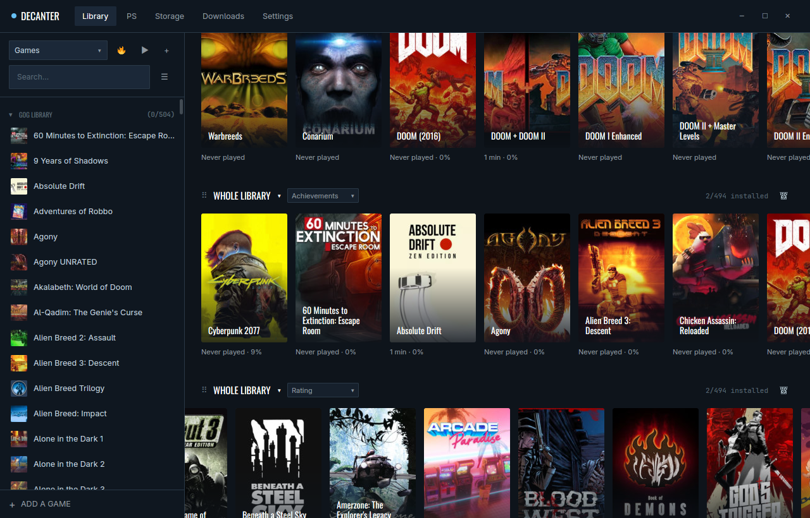
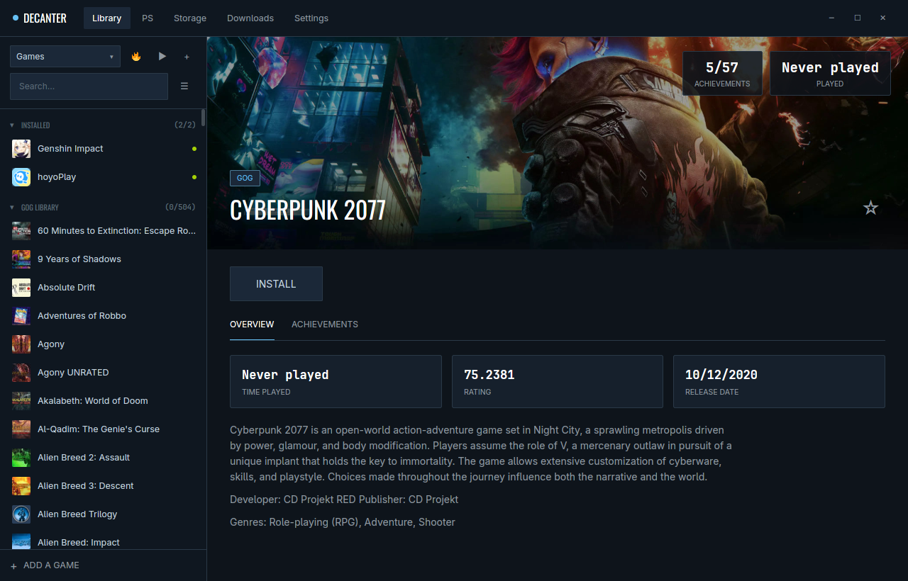
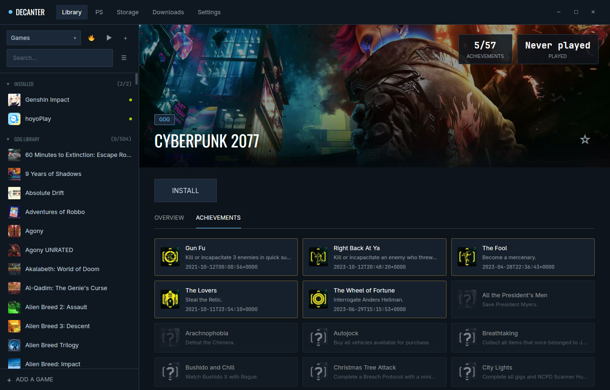
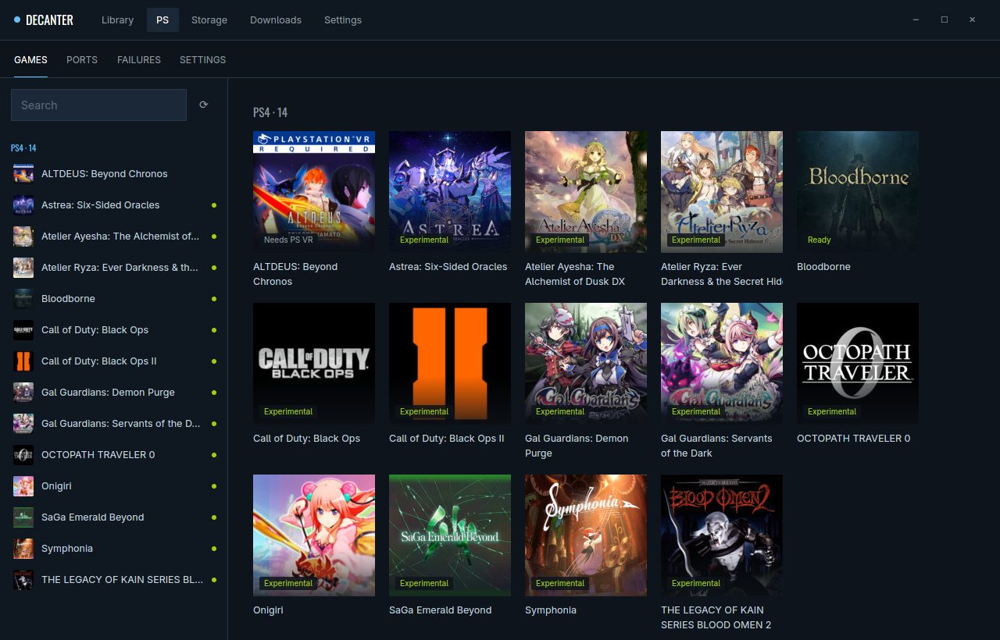
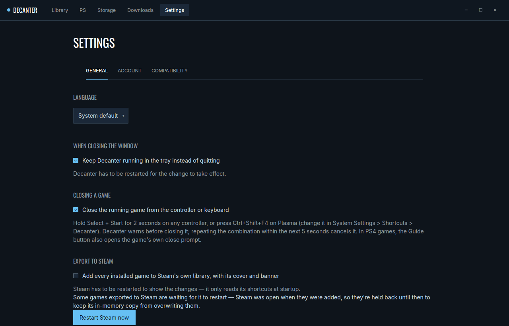

# Decanter

A Linux game launcher for GOG and other Windows games, with achievement
tracking that also sees unlocks earned under Wine, and a section that runs
your own PS4 dumps through psport.

[](https://github.com/yerasuu/decanter/actions/workflows/ci.yml)
[](LICENSE)
[](https://github.com/yerasuu/decanter/releases/latest)

## What it does

- **GOG.** Log in with one or more GOG accounts, browse the library,
  install, update, roll back to an earlier build, manage DLC and betas, and
  sync a game's saves with GOG Cloud Saves before launch and after exit.
- **Achievements.** GOG achievements are shown per game. Games that use
  Galaxy get decanter's own `Galaxy64.dll` proxy at install time, which
  records unlocks earned under Wine that GOG's client never sees. Those
  unlocks stay local: decanter cannot report them to GOG.
- **Proton.** Windows games run through Proton via `umu-run`, each in its
  own prefix, with a default Proton in Ajustes and a per-game pin in the
  game's properties.
- **Other Windows games.** Add any executable, run a game's own installer,
  or import a game from another tool's prefix (Lutris, Bottles, Heroic,
  Proton). Games that HoYoPlay or GRYPHLINK installed inside a prefix can
  be added as their own entries. Art comes from Steam, or from SteamGridDB
  with your own API key.
- **PS section.** Runs your own decrypted PS4 dumps through
  [psport](https://github.com/yerasuu/psport), a compatibility layer in the
  manner of Wine, not an emulator: the game's x86-64 code runs as it is and
  the port provides the console's system libraries. PS5 dumps run through
  [AnyPS5](https://github.com/boykopovar/AnyPS5).
- **Desktop.** Each game gets its own desktop entry and icon, so the task
  bar shows the game, and runs in its own systemd scope. Also a tray icon,
  an optional export of installed games to Steam's library, and a shortcut
  to close the running game from a controller or the keyboard.

Decanter ships no games, firmware or system modules. You bring your own
legally obtained dumps.

The interface is in Spanish (Spain) and English.

## Screenshots







## Install

### AppImage

Download `Decanter-x86_64.AppImage` (or `Decanter-aarch64.AppImage`) from
the [latest release](https://github.com/yerasuu/decanter/releases/latest),
make it executable and run it:

```
chmod +x Decanter-x86_64.AppImage
./Decanter-x86_64.AppImage
```

The AppImage carries the glibc it was built against, so it also runs on
hosts with an older one, such as SteamOS. To update, replace the file with
a newer release.

What the host needs:

- A Vulkan driver for the GPU. Without one, rendering falls back to GL.
- A D-Bus Secret Service (KWallet or GNOME Keyring), where GOG tokens,
  the SteamGridDB key and the shadNet password for PS online play are kept.
- Optional: a systemd user session (each game gets its own scope; without
  one games start as decanter's children), KDE Plasma for the global
  close-game shortcut, and Steam for the Steam export.

`umu-run` does not need to be installed: decanter downloads its own copy
(umu-launcher 1.4.4) into the library. Proton is whatever umu picks or a
build installed for Steam.

### Packages

The release also has `.deb`, `.rpm` and pacman packages for x86_64
(`amd64`) and aarch64 (`arm64`). They hold the same build as the AppImage,
glibc included, under `/opt/decanter`, and add a `decanter` command, a
desktop entry and an icon. Install the file for your system with its
package manager:

```
sudo apt install ./decanter_<version>-1_amd64.deb                  # Debian, Ubuntu
sudo dnf install ./decanter-<version>-1.x86_64.rpm                 # Fedora
sudo pacman -U decanter-<version>-1-x86_64.pkg.tar.zst             # Arch Linux
```

Packages don't update themselves: install the next release's package over
it. The host needs the same as for the AppImage.

### From source

See [Development](#development).

## First steps

1. On the first start, pick the language and create a profile, choosing
   the folder where its library lives (installs, Proton prefixes and
   decanter's own data go there).
2. In Ajustes > Cuenta (Settings > Account), add a GOG account: open GOG,
   log in, and paste the address of the page you land on.
3. Install games from Biblioteca (Library). Updates, versions, DLC, cloud
   saves and the Proton pin are in each game's Propiedades (Properties).
4. Add other Windows games with Añadir juego (Add game) in Biblioteca.
5. For PS games, use Añadir volcado (Add dump) in the PS section, or drop a
   dump's folder on the window: decanter copies or moves it, as you choose
   each time, into `<root>/psport/games/<name>/`. A dump left loose in that
   folder is put in a folder of its own on the next scan. The port is
   prepared (fetched prebuilt or built) when a game is played.

## PS section

| Title | Status |
|---|---|
| Bloodborne (`CUSA03173`, version 01.09) | Supported. A base dump with a 1.09 update beside it is offered a merge. |
| Other PS4 titles | Experimental: they start with the imports the port lacks stubbed, and the log shows how far they get. |
| Titles that need PS VR (bit 26 of `ATTRIBUTE` in `param.sfo`) | Shown as unsupported; they can't be started. |
| PS5 titles | Run through AnyPS5, converted first. |

Which psport builds a library runs is its channel, set in the PS section's
Ajustes:

- **Release** (default) stays on the tag psport's CI last published and
  runs that release's bundle (`psport-<tag>-x86_64.tar.zst`, checked
  against its published SHA-256 and extracted to
  `<root>/psport/ports/bbport-bundles/<tag>/`) with the host's Vulkan
  drivers and no Nix at all. A release without a bundle is fetched from
  psport's Nix binary cache instead; when that lookup fails too, it builds
  locally and says so.
- **Testing** follows psport's `develop` branch and builds every commit
  locally.

Builds use the host's tools when they can configure the port, and fall
back to decanter's own Nix toolchain (nix-portable when the system has no
Nix) when they can't. A folder with your own dump of the console's system
modules can be set in Ajustes, but no title needs it today: it is only for
comparing against the port's own libraries.

Online play is off by default and set up in the same Ajustes, on psport
builds whose `--list-features` lists `online_module`: the shadNet server
(default `play.seamlesshunt.com:31313`), its WebAPI (empty: the server's
own on port 31315), the community server (default
`http://play.seamlesshunt.com`), the account's Online ID (NPID) and UPnP.
decanter creates no accounts. The password and the optional token go to the
keyring under `shadnet/<NPID>/…`, never to the library. With an Online ID
set, a launch with online play on refuses to start, and says why, when the
keyring can't be read or holds no password for it; without an Online ID the
game plays online without shadNet and needs no keyring. **Probar
conexión** checks the three servers as psport's `scripts/online.py check`
does, only when clicked. Bloodborne's Online tab (Bloodborne only; other
PS4 titles have none) adds BBSC, its seamless
co-op (`PS_BBSC`), and whether BBSC's game server runs on this PC (never,
always, or when the community one doesn't answer: `PS_BBSC_LOCAL_SERVER`),
shown when psport's `--online-overrides` declares the extension. psport's
`run.sh` does the rest: certificates, host overrides and the local server.

Per-title progress and what psport adds: [docs/ps4-ports.md](docs/ps4-ports.md).
What each title imports and what the port still lacks:
[docs/ps4-import-matrix.md](docs/ps4-import-matrix.md).

## Where data lives

Everything decanter stores lives inside the library root (`<root>`), so a
library can be moved or copied with its profiles:

| Path | Contents |
|---|---|
| `<root>/decanter/decanter.db` | Profiles, accounts, game cache, achievements, playtime, collections, settings |
| `<root>/decanter/art/` | Art cache |
| `<root>/decanter/bin/` | `umu-run` |
| `<root>/decanter/desktop/`, `<root>/decanter/icons/` | Per-game desktop entries and icons |
| `<root>/decanter/logs/` | Decanter's log and each Proton game's run logs |
| `<root>/psport/` | Everything PS: games, ports, toolchain, settings, mods, logs |
| `<root>/common/`, `<root>/manifests/`, `<root>/compatdata/` | Game files, install manifests, Proton prefixes |
| `<root>/downloading/` | GOG installs in progress |

A library can span several folders, added and removed in Almacenamiento
(Storage); each game lives whole in one of them.

Outside the library only what cannot move:

- `~/.config/decanter/libraries.toml`: the known libraries, the active one
  and its last profile. The only pointer decanter needs.
- `~/.local/share/applications/decanter/`: one symlink per game, because
  Plasma only reads its own folders.
- The keyring (service `dev.decanter.Decanter`), Steam's own files, umu's
  shared runtime, and `decanter.lock` in `$XDG_RUNTIME_DIR`.

**Upgrading from 0.2.** The first start of 0.3 copies the old
`~/.local/share/decanter` data into each library, checks it, and only then
writes `libraries.toml`. It waits while another decanter or a game it
started is running, or while a library's disk is missing. The old folder
is left untouched as a backup: older builds keep reading it, deleting
`libraries.toml` returns to it, and Ajustes > Almacenamiento offers to
remove it. Details: [docs/data-in-library.md](docs/data-in-library.md).

## Configuration and CLI

| Option | Effect |
|---|---|
| `--library <root>` | Use this library for one run instead of the active one. Absolute path only. |
| `DECANTER_LIBRARY=<root>` | Same, from the environment. |
| `DECANTER_PS_BINARY_CACHE=<url>` | Another copy of psport's binary cache (`http://` or `file://`). |
| `DECANTER_PS_BUNDLES=<url>` | Another place for psport's release bundles, as `<url>/<tag>/<asset>` (`http://` or `file://`). |

A library that does not exist is reported, never created.

Without a subcommand `decanter` opens the window. The same binary also
runs headless, one GOG account at a time (`--account-id`). On Windows
`decanter.exe` has no console, so run the subcommands through
`decanter-cli.exe`, shipped next to it (it starts `decanter.exe` with the same
arguments and prints its output in the terminal):

| Subcommand | Does |
|---|---|
| `library` | Lists the account's GOG library |
| `install --product-id … --title …` | Installs a game (`--branch`, `--build-id` optional) |
| `cancel-install --product-id …` | Cancels an install left running |
| `launch --product-id …` | Launches an installed game, waits, then polls achievements |
| `achievements --product-id …` | Polls achievements without launching |
| `hook-diagnostics --product-id …` | Lists recorded `Galaxy64.dll` hook failures |

Language: decanter follows `LC_ALL`, `LC_MESSAGES` or `LANG` (Spanish when
it starts with `es`, English otherwise) unless one is chosen in
Ajustes > General. The CLI and everything decanter writes to disk stay in
English.

## Closing a game

While a game decanter started is running, hold Select + Start for two
seconds on any controller, or press Ctrl+Shift+F4 on Plasma (changeable in
System Settings > Shortcuts > Decanter). Decanter warns, and closes the
game five seconds later unless the combination is repeated. It can be
turned off in Ajustes > General.

## Troubleshooting

- **Logs.** Decanter's own log is
  `<root>/decanter/logs/decanter-YYYY-MM-DD.log` (one per UTC day, two weeks
  kept, in English, secrets stripped); the same lines go to stderr. Each
  Proton game's whole output is in the same folder and shown in the
  game's Registro (Log) tab.
- **PS games.** Each job's output (build, conversion, run) is a log under
  `<root>/psport/logs/`, 30 kept per kind and game, shown in the game's
  Registro tab. Fallos (Failures) lists what the port left unimplemented
  on each run, starting with the imports the game actually called.
- **"Library unavailable".** The library in `libraries.toml` or
  `--library` cannot be found. If it is on an external drive, plug it in
  and reopen decanter, or pick another folder.
- **Switching or moving a library is refused.** Close running games,
  installs and any other decanter window first.
- **Exported games don't show in Steam.** Steam reads its shortcuts only
  at start; decanter holds the change while Steam is open and offers to
  restart it.
- **A source build won't start with `GLIBC_2.xx' not found`.** The binary
  links against nix's glibc, which can be newer than the host's. Start it
  through nix's loader from inside the shell:

  ```
  nix-shell --run '$(cc -print-file-name=ld-linux-x86-64.so.2) target/debug/decanter'
  ```

## Development

### Layout

| Path | What |
|---|---|
| `app` | The `decanter` binary: GPUI views, CLI, tray, desktop integration; `decanter-cli` (Windows), its console front end |
| `crates/core` | Local state: database, libraries, profiles, accounts, credentials, migration |
| `crates/gog` | GOG client: auth, library, installs, cloud saves, achievements, Steam export |
| `crates/runtime` | Proton launches through `umu-run` |
| `crates/ps` | PS dumps, port builds and updates, toolchain, runs, run logs, failures |
| `crates/hook` | `Galaxy64.dll` proxy, a Windows cdylib outside the workspace |

UI texts live in `app/locales/`, a folder per language (`es/`, `en/`) with
one YAML file per area, `<area>.<language>.yml`, and `_language.<language>.yml`
for the language's own name. A language is added by copying `es/`, renaming
the files and translating them: the language picker and the system locale
match find it with no code change.

### Build

`shell.nix` pins everything: the libraries GPUI loads at run time, the
mingw cross toolchain for `crates/hook`, and the TLS and Vulkan setup.

```
nix-shell --run 'cargo run'                                # dev build
nix-shell --run 'cargo build --release'                    # release binary
nix-shell --run 'cargo fmt --all --check'                  # checked by CI
nix-shell --run 'cargo clippy --workspace --all-targets'   # checked by CI
scripts/appimage                                           # target/appimage/Decanter-x86_64.AppImage
```

Without Nix, the same `cargo` commands need:

- Rust with the `x86_64-pc-windows-gnu` target
  (`rustup target add x86_64-pc-windows-gnu`), a mingw-w64 cross gcc and
  its `libpthread.a`: `crates/gog/build.rs` always cross-compiles the hook
  and fails the build without them.
- `pkg-config` and what GPUI and the keyring load at run time:
  `vulkan-loader`, `wayland`, `libxkbcommon`, the X11/xcb libraries,
  `fontconfig`, `freetype`, `dbus`, `openssl`. `runtimeLibs` in `shell.nix`
  is the exact list.

### Conventions

- `unsafe_code` is forbidden; clippy runs with `all`, `pedantic`,
  `restriction` and `nursery` at warn and a deny list in the workspace
  `Cargo.toml` (no `unwrap`, `expect`, `panic!`). Format with `cargo fmt`
  (`max_width = 120`).
- No tests in the repository. A change to PS emulation behaviour comes with
  a hardware test written as OpenOrbis homebrew.
- Branches: `main` (releases, one tag per version), `develop` (integration)
  and `<type>/<id>-<topic>` per task, integrated by rebase and fast-forward.
  Commits follow Conventional Commits (`type(area): subject`) and are
  signed. Enable the commit-msg hook with
  `git config core.hooksPath .githooks`. Full guide:
  [docs/git-workflow.md](docs/git-workflow.md) and
  [docs/git-conventions.md](docs/git-conventions.md).
- Versions are derived from the commits in the range (below 1.0, a
  breaking change bumps `y` in `0.y.z`). Each version's notes are written
  first in `tag-changelog/vX.Y.Z.md`; the build fails without the file for
  the current version, and CI publishes it with the AppImage when a `v*`
  tag is pushed. [CHANGELOG.md](CHANGELOG.md) groups the same changes by
  area.

## Related projects

- [psport](https://github.com/yerasuu/psport): the PS4 compatibility layer
  decanter builds and runs, derived from
  [bbport](https://github.com/deadinside28/bloodborne_pc).
- [AnyPS5](https://github.com/boykopovar/AnyPS5): runs PS5 dumps.
- [umu-launcher](https://github.com/Open-Wine-Components/umu-launcher):
  runs Proton outside Steam.

## License

Decanter is free software under the GNU General Public License, version 3
or (at your option) any later version: see [LICENSE](LICENSE). The ports it
builds and runs keep their own licenses.
