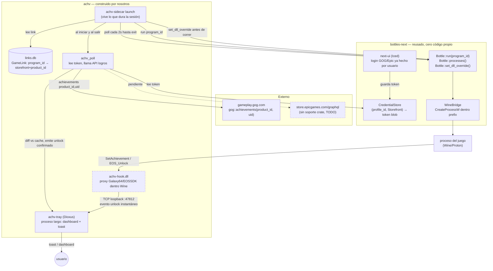

# Detección logros GOG/Epic bajo Proton — concepto final

Diagrama arquitectura completa. Tres zonas: reusado de bottles-next (sin tocar), construido por nosotros (achv-*), y servicios externos (GOG/Epic).

## Qué significa cada línea

- **Sólido** = camino implementado/confirmado contra código real de bottles-next.
- **Punteado** = capa1 (hook DLL) y Epic achievements — experimental / sin resolver aún, no bloquea el resto.

## Reparto de trabajo

| Pieza | Quién la construye |
|---|---|
| Auth GOG/Epic | bottles-next (`CredentialStore` + next-plugin-gog/egs) |
| Runner/prefix/DLL override | bottles-next (`Bottle`, `WineBridge`) |
| Logros GOG | achv, wrapper trivial sobre `gog::achievements()` |
| Logros Epic | achv, sin soporte upstream, pendiente |
| Launch/exit detection | achv, propio (bottles-core no emite estos eventos) |
| GameLink (program↔juego) | achv, propio (`Program` no tiene ese campo) |
| Hook DLL tiempo real | achv, experimental, zona gris ToS |
| Notificación/dashboard | achv-tray, Dioxus |
